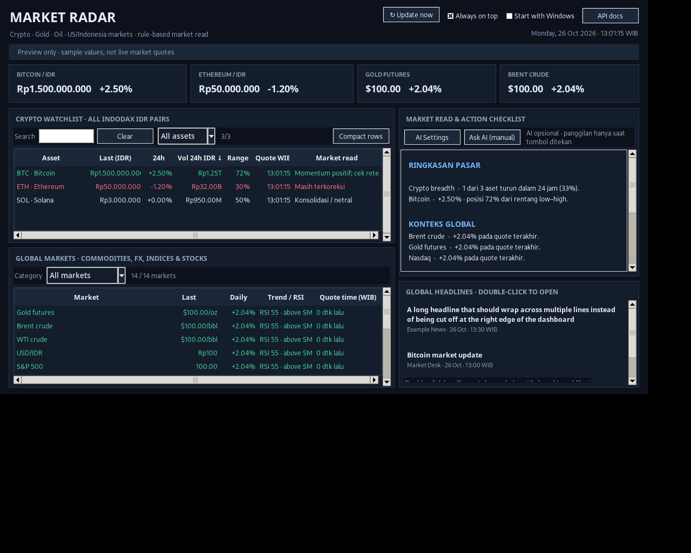
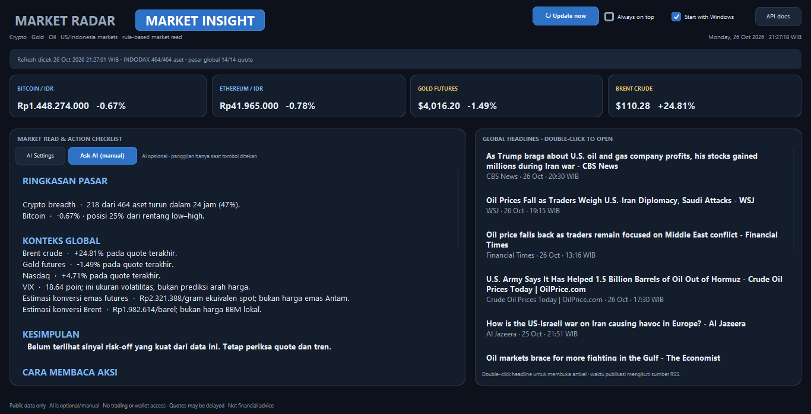

# Market Radar — Windows Desktop Dashboard

**Market Radar v1.7.0** is a lightweight Windows dashboard for public crypto and global-market data, with rule-based context and optional manual AI analysis. **It does not trade, connect to exchange accounts, or access wallets.**

## What's new in v1.7.0

- **Header navigation:** `MARKET RADAR` opens page one; `MARKET INSIGHT` sits beside it and opens page two. Both use the same large, bold typography and remain outside the data panels.
- **Resizable side-by-side panels:** both pages use a draggable divider between their left and right panels. Resize it to give the crypto table, global markets, market read, or headlines more horizontal space.
- **More table room:** page one shows the crypto watchlist beside global markets; page two shows the market read/action checklist beside global headlines. Status, summary cards, and controls remain visible when switching pages.
- **Retained CustomTkinter UI:** rounded cards, buttons, entries, dropdowns, and scrollbars remain, with native `ttk.Treeview` tables for sorting and color semantics.
- **Action guide:** the Market Insight page now briefly defines every action label and clarifies that TP Watch does not mean selling the entire holding.

## Features

- **INDODAX IDR pairs:** dynamic catalogue from the public API rather than a hard-coded coin list. The watchlist defaults to 24-hour IDR volume descending.
- **Global markets:** Gold futures, Brent/WTI crude, USD/IDR, S&P 500, Nasdaq Composite, IHSG, VIX, NVIDIA, Apple, Microsoft, and Indonesian stocks BBCA/BBRI/TLKM.
- **Crypto table:** local search by symbol/name, `All assets`/`Gainers`/`Losers`/`High volume` filters, sortable columns, and compact IDR volume formatting.
- **Global-market table:** filter by commodities, FX, indices, or stocks and sort by market, last price, daily change, technicals, or quote time.
- **Rule-based market read:** crypto breadth, BTC change/range, oil/gold/index context, and a cautious entry/exit checklist with per-asset action labels. It is an interpretation aid, not a trading signal.
- **Google News RSS:** optional feed; double-click a headline to open the source article. Publication times depend on the feed.
- **Optional OpenRouter AI:** `Ask AI (manual)` sends one snapshot only when pressed. AI is not called automatically on refresh. The default model is `openrouter/free`; model availability and quotas can change.
- **Convenience:** manual refresh, automatic refresh, clock in WIB, optional always-on-top, and start-with-Windows controls. A desktop-shortcut helper and app icon are included.

## Action labels in plain language

These are watch labels based on a small set of 24-hour quote/range rules—not guaranteed buy/sell calls. The app does not know your entry price, quantity, or risk limit.

- **BUY WATCH:** potential entry candidate, not “buy immediately”; wait for price to reclaim and hold a watched level on retest.
- **HOLD / WATCH:** keep monitoring; not a new-entry signal.
- **TP WATCH:** price is near its 24-hour high. A holder may consider taking *partial* profit according to their plan; it does not mean sell everything.
- **SELL REVIEW:** selling pressure is strong; check your pre-set stop/risk plan. It is not an automatic exit instruction.
- **NO BUY:** avoid opening a new position while price is falling hard near the 24-hour low.
- **WAIT / RISK:** momentum is negative; wait for stabilization and check risk if already holding.
- **HOLD / WAIT:** movement is relatively flat; no clear setup.
- **WAIT:** insufficient 24-hour change data to classify.
- **STALE / WAIT:** quote is too old to trust for a fresh decision.
- **NO DATA:** quote unavailable; no usable action signal.

**Entry vs. exit:** `BUY WATCH` is only a *possible entry to investigate*. `TP WATCH` and `SELL REVIEW` are *exit/position-review prompts*, not sell commands. Stop-loss is not personalized or automatically triggered by the app; set it before entering and follow your own risk rules.

## Using the tables

### Crypto

Use the search field to find an asset by symbol or name. Search is local and does not trigger additional network calls. Choose a quick filter next to it. `Compact rows` changes the row height of both tables; click a column heading to sort, and click the same heading again to reverse direction. Missing values stay at the bottom.

`Vol 24h IDR` uses compact units (`K`, `M`, `B`, `T`) so high-volume pairs fit the table. Low-priced assets retain decimal precision (for example, a price below Rp1 will not be rounded to `Rp0`). Quote timestamps are retained where the source provides them; stale quotes are marked and receive a non-actionable status. Select an asset row to view its conditional entry/exit references.

### Global markets

Select a category to narrow the 14 configured instruments. Stock/futures quotes generally move during the relevant exchange session and may look unchanged outside market hours, on holidays, or when Yahoo Finance has delayed/stale data. The app uses Yahoo Finance’s unofficial chart endpoint; it does not poll every instrument tick-by-tick. The crypto and global-market tables are side by side on page one. Drag the divider between panels to choose their widths. Use the horizontal scrollbar inside a table if a narrow display clips some columns.

## Install and run

1. Install **Python 3.11 or newer** from [python.org](https://www.python.org/downloads/windows/) and ensure Tkinter is available.
2. Extract the project folder to a permanent location.
3. Double-click `Run_Market_Radar.bat`. On first run it checks for CustomTkinter and attempts to install the dependency from `requirements.txt` if it is missing. An internet connection is required for that first installation.
4. To create a desktop shortcut with the app icon, keep the project in its permanent folder and double-click `Create_Desktop_Shortcut.bat`. The shortcut will point to that folder, so do not move the project afterward.
5. If startup fails, run `Run_Market_Radar_Debug.bat` to see the error output.

To install the dependency manually from PowerShell in the project folder:

```powershell
py -3 -m pip install -r requirements.txt
```

## Optional AI setup

1. Create a key at [OpenRouter API Keys](https://openrouter.ai/settings/keys).
2. In the app, open **AI Settings**, paste the key, and choose a model ID if needed.
3. Save, then click **Ask AI (manual)** to analyze the current market snapshot.

The API key is **not stored in source code or this repository**. On Windows, the app encrypts a saved key with Windows DPAPI and stores it outside the project at `%APPDATA%\MarketRadar\settings.json`. This file must not be uploaded to GitHub. You can remove the saved key from the AI Settings dialog. An `OPENROUTER_API_KEY` environment variable is also supported.

Manual AI calls may use account quota. Free model routing does not guarantee capacity or speed, and requests can fail if a provider or quota is unavailable. The dashboard remains usable without AI.

## Data sources and refresh cadence

- **Crypto:** `https://indodax.com/api/pairs` and `https://indodax.com/api/summaries` from the public INDODAX API. If the pair catalogue is unavailable, the app attempts a dynamic fallback from summaries.
- **Commodities, FX, indices, and stocks:** Yahoo Finance chart endpoint (unofficial; the endpoint can change, quotes can be delayed, and requests can fail).
- **News:** Google News RSS; results can be delayed or unavailable.
- Crypto refresh: about **90 seconds**. Global-market refresh: about **5 minutes**. RSS refresh: about **15 minutes**. These run automatically; `Update now` remains available for a manual refresh. Macro values can remain unchanged if the underlying market is closed or the source has not published a new quote. Quote timestamps are shown where available.

## Tests

Run the offline tests from the project directory after installing `requirements.txt`:

```powershell
python -m unittest -v test_market_radar.py
```

The test suite covers INDODAX pair parsing/fallback (including fractional prices), IDR formatting, action labels and conditional entry/exit references, stale-quote handling, local search and quick filters, market-read structure, sorting, RSI, and encrypted settings behavior.

## Limitations and safety

Market read and AI answers can be wrong. Verify data and sources independently; nothing here predicts a guaranteed bottom, guarantees profit, or constitutes personal financial advice. `BUY WATCH`, `TP WATCH`, and `SELL REVIEW` are conditional labels, not instructions to place orders. Entry/midpoint, low and high references are calculated from the last reported 24-hour range, not validated by candle, volume-profile, or portfolio data. The dashboard only reads public data. It does not log in to INDODAX, access an exchange account or wallet, place orders, or trade.

## Files

- `market_radar.py` — application source.
- `Market_Radar.ico` — Windows/app icon.
- `Create_Desktop_Shortcut.bat` / `Create_Desktop_Shortcut.ps1` — creates a desktop shortcut to the project launcher.
- `Run_Market_Radar.bat` — normal launcher with a dependency check.
- `Run_Market_Radar_Debug.bat` — launcher with visible errors and dependency check.
- `requirements.txt` — CustomTkinter dependency.
- `test_market_radar.py` — offline tests.

## Preview

> Preview note: this screenshot uses synthetic layout-test values; figures shown are not live market quotes.

> The repository preview image is from an older layout. Replace it with a fresh screenshot after checking v1.6.2 on Windows.



